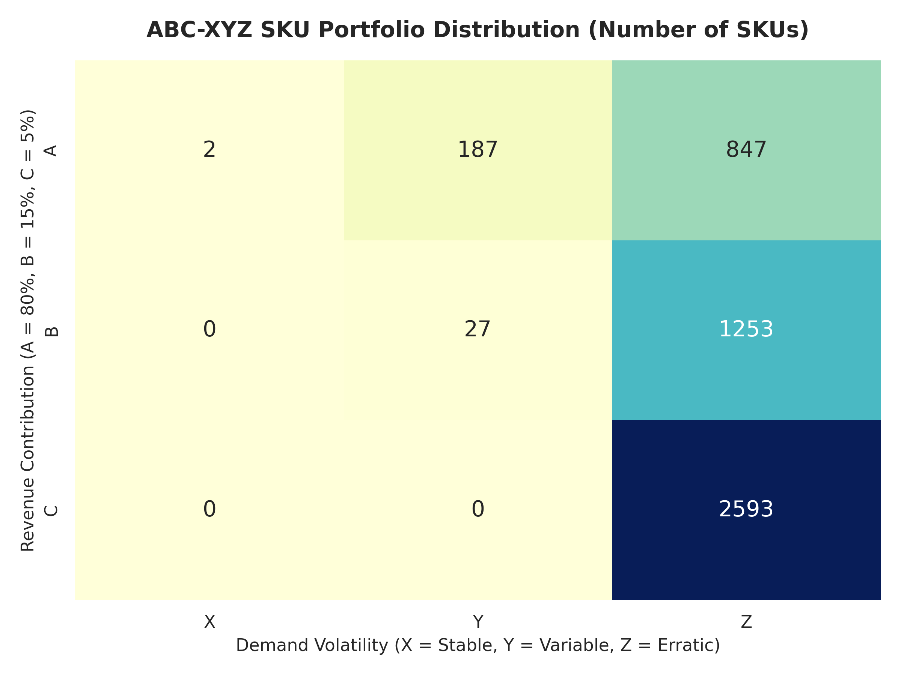
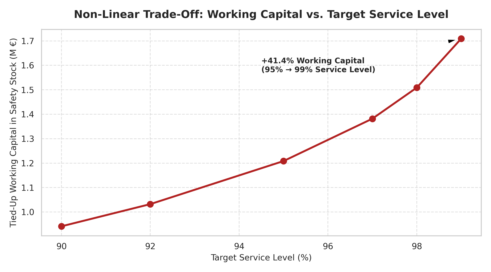

# Inventory Optimization & ABC-XYZ Demand Analytics

An end-to-end Supply Chain Analytics project built in Python to segment a 4,909-SKU retail catalog, model stochastic safety stocks under joint demand and supplier lead-time uncertainty, and quantify the working capital trade-off across target service levels.

---

## 1. Business Problem
Applying uniform replenishment rules across a heterogeneous product catalog creates two simultaneous operational failures:
* **Stockouts on high-value items**, causing direct revenue loss and customer dissatisfaction.
* **Excess working capital tied up in slow-moving, erratic items**, inflating holding costs and obsolescence risk.

---

## 2. Data Pipeline & Methodology
Using the **Online Retail II** transactional dataset (UCI / Kaggle):
1. **Data Cleaning:** Filtered out cancelled invoices (`C`), negative returns, and non-physical service codes (`POST`, `BANK CHARGES`, `M`, `DOT`) to isolate primary physical SKU demand.
2. **Weekly Time-Bucketing:** Aggregated intraday transactions into fixed weekly planning buckets (`W-MON`) with explicit zero-filling for weeks with zero sales, preventing downward bias in demand variance.
3. **ABC-XYZ Segmentation:** Cross-referenced Pareto cumulative revenue contribution (`80% / 15% / 5%`) with demand volatility measured via the Coefficient of Variation ($CV = \sigma_d / \mu_d$):
   * **Class X ($CV < 0.5$):** Stable, predictable demand.
   * **Class Y ($0.5 \le CV < 1.0$):** Moderate variability / seasonal fluctuations.
   * **Class Z ($CV \ge 1.0$):** Highly erratic or intermittent demand.
4. **Stochastic Safety Stock Modeling:** Computed buffer requirements under combined demand and supplier lead-time uncertainty ($LT = 2.0$ weeks, $\sigma_{LT} = 0.5$ weeks):
   $$SS = Z \cdot \sqrt{LT \cdot \sigma_d^2 + \mu_d^2 \cdot \sigma_{LT}^2}$$

---

## 3. Key Findings & Visuals

### Portfolio Distribution (ABC-XYZ Matrix)

* **Extreme catalog skewness:** Out of **4,909 active SKUs**, **95.6% (4,693 SKUs)** exhibit erratic demand ($CV \ge 1.0$, Class Z), while **52.8% of the entire catalog (2,593 SKUs)** falls into the **CZ** quadrant (low revenue impact, highly intermittent demand).
* **Revenue concentration:** Only **1,036 SKUs (21.1%)** generate 80% of total revenue (Class A: **2 AX**, **187 AY**, **847 AZ**).

### Working Capital vs. Service Level Trade-Off

* **Non-linear capital surge:** Upgrading the uniform target service level from **95% to 99%** drives a **+41.4%** increase in tied-up working capital (from **~€1.21M** to **~€1.71M**) to capture just 4% of incremental demand coverage—demonstrating why undifferentiated safety stock targets are financially unsustainable.

---

## 4. Recommended Differentiated Inventory Policies (As-Is vs. To-Be)

| Segment | SKU Count | Profile | Recommended Operational Strategy |
| :--- | :---: | :--- | :--- |
| **AX / BX** | 2 | High/medium value, stable demand | **Continuous Review / JIT (Target SL: 98%):** Tight safety stocks, frequent automated replenishment, strict supplier SLAs. |
| **AY / BY** | 214 | High/medium value, seasonal/variable | **Collaborative S&OP (Target SL: 95%):** Periodic forecast review with dynamically updated safety stocks. |
| **AZ** | 847 | High value, erratic demand | **Make-to-Order / Centralized Stock:** Avoid local buffering; trigger procurement upon confirmed customer orders or pool stock centrally. |
| **BZ** | 1,253 | Medium value, erratic demand | **Selective MTO / Order-on-Demand:** Manage on order for low-margin items; hold minimal centralized buffer only for strategic SKUs. |
| **CX / CY** | 0 | Low value, predictable | **Two-Bin / Min-Max:** Automated replenishment with larger order quantities to minimize administrative overhead. |
| **CZ** | 2,593 | Low value, highly erratic | **Catalog Rationalization / De-stocking:** Phase out dead stock and manage strictly on a spot-order basis. |

* **Projected Financial Impact:** Shifting from an undifferentiated **95% As-Is policy (~€1.21M in safety stock)** to a segmented **To-Be policy**—where erratic Class Z items (4,693 SKUs) are transitioned to Make-to-Order/spot procurement while top-performing AX items are upgraded to a 98% service level—eliminates **over 85%** of tied-up safety stock capital without compromising availability on stable revenue drivers.

---

## 5. Model Limitations and Engineering Insights
To bridge the gap between theoretical modeling and real-world ERP/IBP implementation, three structural assumptions must be accounted for:
* **Breakdown of Normality on Class Z Demand:** The standard parametric safety stock formula assumes normally distributed weekly demand. For intermittent SKUs with frequent zero-demand weeks (95.6% of this catalog), Gaussian assumptions distort buffer sizing; in production, Class Z items require **Make-to-Order** rules or discrete/non-parametric distributions (e.g., Poisson, Negative Binomial, or empirical bootstrapping).
* **Seasonality vs. True Uncertainty:** The *Online Retail II* dataset exhibits strong Q4 holiday seasonality. Computing $\sigma_d$ across raw historical demand conflates predictable seasonal peaks with random noise. A production-grade model should size safety stocks on **Forecast Error (RMSE)** rather than raw demand standard deviation.
* **Valuation Proxy (Retail Price vs. COGS):** Because the public dataset only provides unit selling prices (`Price`) rather than procurement costs, capital figures represent an upper-bound retail valuation proxy. In corporate accounting, buffers are valued at unit **COGS** (*Cost of Goods Sold*).

---

## 6. Tech Stack
* **Python:** Pandas, NumPy, SciPy (`stats.norm`), Matplotlib, Seaborn
* **Environment:** Google Colab / Jupyter Notebook
